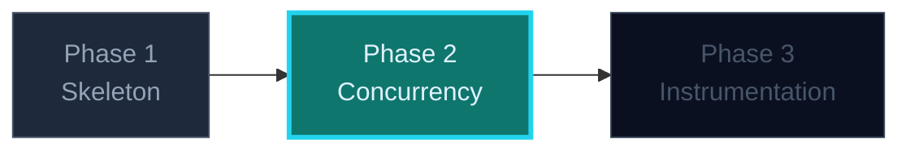

## Phase 2 — Concurrency You Can Stop

Go makes concurrency cheap, which makes *unbounded* concurrency the default
mistake. This phase adds the two things that separate a demo from a service:
**bounded work** and **a shutdown that does not lose data**.

### Where this fits



---

### Three things to see instantly

> 🧠 **A queue with no bound is an outage waiting for load.** The buffered channel
> is the backpressure mechanism. When it is full, you must *decide*: block, drop,
> or reject. Choosing nothing means Go blocks the handler, connections pile up,
> and the failure spreads upward.

1. **Goroutines are not free but they are cheap** — a worker pool sized by config
   keeps latency predictable. One goroutine per request is a decision, not a
   default.
2. **`context` is the cancellation boundary.** It flows from `main` into every
   blocking call. `context.WithTimeout` on shutdown is what buys you a bounded,
   observable exit.
3. **SIGTERM is a request, not an event.** On SIGTERM: stop accepting, drain,
   then exit 0. Something has to be listening — `signal.NotifyContext` wires it in
   one line.

### The decision that matters

When the queue is full, the honest answer for a telemetry ingest service is
**reject with 503 and a retry hint**:

```go
select {
case s.queue <- ev:
    s.accepted.Add(1)
    w.WriteHeader(http.StatusAccepted)
default:
    // Deliberate: fast rejection beats silent loss or unbounded latency.
    s.rejected.Add(1)
    w.Header().Set("Retry-After", "1")
    http.Error(w, "queue full", http.StatusServiceUnavailable)
}
```

Blocking here would be defensible too — but it must be *chosen*, and it changes
what your latency SLI means. Write down which one you picked and why. That
sentence is an interview answer.

### Shutdown that earns its keep

```go
ctx, stop := signal.NotifyContext(context.Background(), syscall.SIGTERM, os.Interrupt)
defer stop()

srv := &http.Server{Addr: ":" + cfg.Port, Handler: mux}
go func() { _ = srv.ListenAndServe() }()

<-ctx.Done()
shutCtx, cancel := context.WithTimeout(context.Background(), cfg.ShutdownGrace)
defer cancel()
_ = srv.Shutdown(shutCtx)  // stop accepting, drain in-flight
close(s.queue)             // now it is safe: no new sends
s.wg.Wait()                // workers finish what they accepted
```

The ordering is the whole lesson. Close the queue *before* `Shutdown` returns and
a live producer panics on send-to-closed-channel. Close it *after* and the drain
is clean.

### What to avoid

- `go func() { ... }()` with no `WaitGroup` — the process exits mid-write.
- Reading `os.Getenv` inside a handler to size the pool.
- A `defer close(ch)` inside a loop, or a close guarded by nothing.
- `time.Sleep` as a shutdown strategy. It is a guess wearing a delay's clothes.

### The one-sentence takeaway

**Bound the queue, choose your overload behaviour explicitly, and make SIGTERM
drain rather than truncate.**
