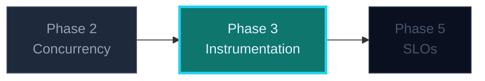

## Phase 3 — Make the Service Observable

Instrumentation is not logging harder. It is deciding, before the incident, which
**numbers** would tell you whether users are being served well — and emitting
exactly those.

### Where this fits


Phase 4 (Terraform) runs alongside this one — either order works.

---

### Three things to see instantly

> 🧠 **An SLI is a ratio, never a count.** "412 errors" cannot tell you whether you
> are healthy. "412 errors out of 90,000 requests, over 5 minutes" can. Every
> metric you add in this phase exists to feed a ratio in Phase 5.

1. **Counters go up.** Requests, rejects, processed events, errors. Never reset
   them; Prometheus handles rate.
2. **Histograms record distributions.** Ingest duration buckets let you compute
   "fraction under 250ms" — which is the latency SLI. An average cannot do this.
3. **Liveness and readiness answer different questions.** `/healthz` = "is the
   process wedged?" `/readyz` = "should traffic reach me *now*?" Wiring a
   downstream dependency into liveness is how one database blip restarts every
   replica at once.

### The two SLIs you are building

```go
// Availability: good events / valid events.
// A "valid" event is well-formed. A malformed one is the client's problem,
// not yours — counting it would let a bad sender spend your error budget.
var ingestTotal = prometheus.NewCounterVec(prometheus.CounterOpts{
    Name: "relayd_ingest_requests_total",
    Help: "Ingest requests by outcome.",
}, []string{"outcome"}) // accepted | rejected | invalid | error

// Latency: a histogram, so we can ask for the fraction under a threshold.
var ingestDuration = prometheus.NewHistogramVec(prometheus.HistogramOpts{
    Name:    "relayd_ingest_duration_seconds",
    Buckets: []float64{0.05, 0.1, 0.25, 0.5, 1, 2.5},
}, []string{"route"})
```

Those two, plus a gauge for queue depth, are enough to run this track. Resist
adding more — a dashboard nobody reads is worse than a dashboard with three panels.

### Labels: the cheapest outage you can create

Every label value is a new time series. `device_id` on a home network is fine;
`event_id` would explode. **Cardinality is a production risk, and it lives in
your hands at instrumentation time**, not in Prometheus's.

### What to avoid

- Timing with `time.Now()` after the work is done instead of `defer` at the top —
  you measure the happy path only.
- A latency bucket list copied from a blog post for a service with 40ms responses.
- Logging the same event *and* incrementing a counter *and* emitting a metric, so
  three sources disagree during the incident.
- Returning `200` on a rejected event. Your availability SLI will report health
  that users do not have.

### The one-sentence takeaway

**Emit two ratios — availability and latency — from histograms and outcome
counters, and keep the label set small enough to survive a bad day.**
