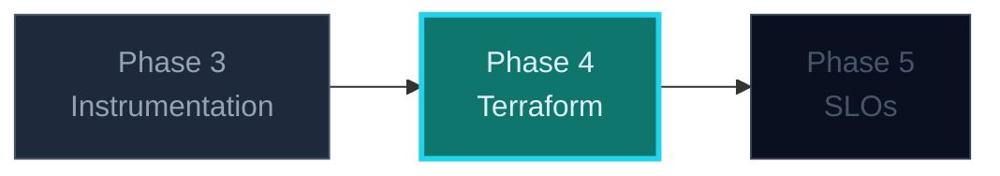

## Phase 4 — Terraform the Whole Stack

Everything so far was started by hand. **Infrastructure as code means the
environment is a file, not a memory of what someone typed.** This phase provisions
the service, the network and Prometheus with Terraform against the local Docker
daemon — real provider, real state, real plan/apply, zero cloud bill.

### Where this fits



---

### Three things to see instantly

> 🧠 **`terraform plan` is a diff of intent against recorded reality.** Terraform
> does not inspect Docker to decide what exists; it compares your `.tf` files with
> its **state file**. That is why state matters, why it is not in git, and why a
> manual change shows up as drift rather than as a surprise.

1. **`init` → `plan` → `apply` → `destroy`** is the whole loop. Read the plan
   every time — the plan is the review.
2. **Variables are the parameter list; outputs are the return values.** Two
   environments from one config is the first genuinely useful thing IaC buys you.
3. **State is the source of truth, and it can lie.** Hand-edit a container and
   `apply` will put it back — because intent wins. That is the feature.

### The smallest stack that teaches everything

```hcl
terraform {
  required_providers {
    docker = { source = "kreuzwerker/docker", version = "~> 3.0" }
  }
}

provider "docker" {}

resource "docker_network" "relay" {
  name = "${var.env}-relay"
}

resource "docker_image" "relayd" {
  name = "${var.image}:${var.tag}"
}

resource "docker_container" "relayd" {
  name  = "${var.env}-relayd"
  image = docker_image.relayd.image_id

  networks_advanced { name = docker_network.relay.name }

  ports {
    internal = 8080
    external = var.host_port
  }

  # Config is passed in, never baked into the image.
  env = [
    "QUEUE_DEPTH=${var.queue_depth}",
    "SHUTDOWN_GRACE=10s",
  ]
}
```

`var.env = "dev"` and `var.env = "staging"` now give you two isolated stacks from
one file. That is the moment IaC stops being ceremony.

### The drift exercise (do not skip)

1. `terraform apply` — note the container ID.
2. `docker rm -f dev-relayd` — simulate a colleague "fixing" something by hand.
3. `terraform plan` — it proposes to **create** the container again.

You have just seen the difference between *what the file says* and *what the world
is*. Every production incident involving "it was working yesterday" is a version of
this.

### What to avoid

- Committing `terraform.tfstate` — it contains resource IDs and, in cloud
  providers, secrets. Add `*.tfstate*` and `.terraform/` to `.gitignore`.
- `-auto-approve` on a plan you have not read.
- Baking config into the image (`ENV QUEUE_DEPTH=256`) so the same image cannot be
  run in two environments.
- Editing resources in the Docker CLI "just this once". That is the drift.

### The one-sentence takeaway

**Write intent, read the plan, let apply converge — and treat state as the thing
you must protect, not the thing you can ignore.**
