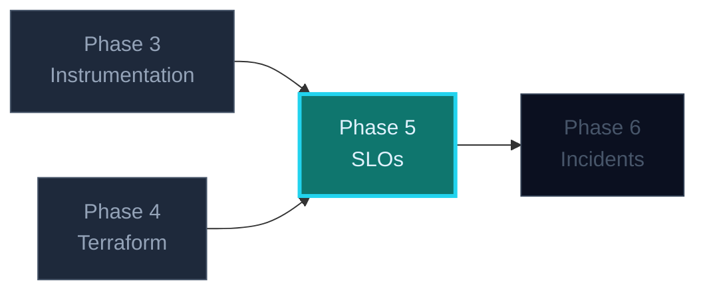

## Phase 5 — SLOs and the Error Budget

You have metrics. This phase turns them into a **decision rule**. An SLO is not a
dashboard; it is a number that answers *"may I ship right now?"* without a meeting.

### Where this fits



---

### Three things to see instantly

> 🧠 **100% is the wrong target.** It is unaffordable and it makes shipping and
> reliability enemies. An SLO of 99.5% says: *we will spend some unreliability
> deliberately, and stop when it runs out.*

1. **SLI** — the measurement. Ratio of good events to valid events.
2. **SLO** — the target over a window. `99.5% of valid ingest requests succeed
   over 28 days`.
3. **Error budget** — the complement. `100% − 99.5% = 0.5%`.

### The arithmetic you should be able to do on paper

0.5% of 28 days:

```
28 days × 24 h × 60 min        = 40,320 min
0.5% of that                   =    201.6 min
                               ≈  3 h 22 min
```

That is the month's allowance for everything: bad deploys, dependency outages,
your own bugs. When the budget is gone, **feature work stops until the service is
back inside its target** — that is the policy, and it is what makes the number real.

### Recording rules

Compute the ratio over several windows; do not query raw counters at 3am.

```yaml
groups:
  - name: relayd-slo
    interval: 30s
    rules:
      # Long window: what the SLO is judged on.
      - record: relayd:sli_availability:ratio_28d
        expr: |
          sum(rate(relayd_ingest_requests_total{outcome="accepted"}[28d]))
          /
          sum(rate(relayd_ingest_requests_total{outcome=~"accepted|rejected|error"}[28d]))

      # Short windows: what alerts look at. Fast enough to catch a real outage.
      - record: relayd:sli_availability:ratio_1h
        expr: |
          sum(rate(relayd_ingest_requests_total{outcome="accepted"}[1h]))
          /
          sum(rate(relayd_ingest_requests_total{outcome=~"accepted|rejected|error"}[1h]))

      - record: relayd:error_budget:remaining_ratio
        expr: 1 - (
          (1 - relayd:sli_availability:ratio_28d) / (1 - 0.995)
        )
```

Note `outcome="invalid"` is **excluded** from the denominator. Malformed client
input is not your unavailability — and including it hands your budget to anyone
who can post garbage.

### The question this phase answers

> *"The 28-day availability is 99.51%. May I deploy the queue-depth change on
> Friday afternoon?"*

You now have an answer, and it is not an opinion.

### What to avoid

- A latency SLO built on averages. Use `histogram_quantile`, or better, the
  fraction-under-threshold form.
- Setting the target from ambition rather than from measured history. Measure for
  a week first, then set the SLO just below what you actually deliver.
- Alerting on the 28-day ratio. It is far too slow to wake anyone — that is
  Phase 6's job.
- An SLO with no owner and no policy. A number nobody acts on is decoration.

### The one-sentence takeaway

**Pick a ratio, set a target you can afford, compute the budget, and write down
what spending it changes.**
