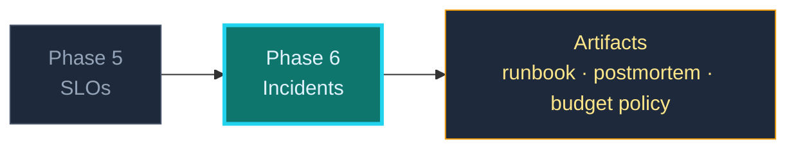

## Phase 6 — Break It on Purpose

An SLO you have never breached is a hypothesis. This phase tests it: inject
failures, predict the alert, then write the artifacts a real on-call engineer is
judged on — a runbook and a postmortem.

### Where this fits



---

### Three things to see instantly

> 🧠 **Multi-window burn-rate alerting exists because one window cannot be both
> fast and quiet.** A 1-hour window catches an outage in minutes and also fires on
> ordinary noise. Pair a long window with a short one and require both: the short
> window proves the problem is *current*, the long window proves it is *material*.

Burn rate = how fast you are spending the budget relative to the SLO. Burning at
**1×** spends the whole 28-day budget in 28 days. At **14.4×** you exhaust a 30-day
budget in ~2 days — the classic fast-burn threshold.

### The two alerts worth having

```yaml
groups:
  - name: relayd-burn
    rules:
      # Fast burn: 14.4x over 1h, confirmed on 5m. Pages.
      - alert: RelaydAvailabilityFastBurn
        expr: |
          (1 - relayd:sli_availability:ratio_1h) > (14.4 * 0.005)
          and
          (1 - relayd:sli_availability:ratio_5m) > (14.4 * 0.005)
        for: 2m
        labels: { severity: page }
        annotations:
          summary: "Burning error budget 14x too fast"
          runbook: "https://…/runbooks/relayd-availability.md"

      # Slow burn: 6x over 6h, confirmed on 30m. Ticket.
      - alert: RelaydAvailabilitySlowBurn
        expr: |
          (1 - relayd:sli_availability:ratio_6h) > (6 * 0.005)
          and
          (1 - relayd:sli_availability:ratio_30m) > (6 * 0.005)
        labels: { severity: ticket }
```

Two alerts, two severities, two audiences. That is the entire alerting strategy for
one service — and it is more than most teams have.

### Inject three faults — predict before you run

| Fault | Command | Predict | Then check |
|---|---|---|---|
| Container dies | `docker kill dev-relayd` | readiness fails, then fast burn after 2m | which alert fires first? |
| Queue saturates | `hey -n 20000 -c 200 …/ingest` | 503s, availability drops, latency stays low | is the SLI measuring the right thing? |
| Latency degrades | add `time.Sleep(400ms)` in the handler | latency SLI burns, availability stays high | does your availability SLO notice at all? |

That last row is the most instructive: **a slow service is often "available"**. If
your only SLO is availability, you have chosen not to care about latency.

### The three artifacts

1. **Runbook** — symptom → first check → likely cause → action → escalation.
   Written for someone woken at 3am who has never seen this service.
2. **Postmortem** — blameless, timeline, contributing factors, and *what changed*.
   Not "human error". A person made a reasonable decision given the information the
   system gave them; the fix is in the system.
3. **Error-budget policy** — what happens at 50% and 100% spent. Without this, the
   SLO is a dashboard. With it, the SLO is a management tool.

### What to avoid

- An alert with no runbook link. The alert is a question; the runbook is the answer.
- Postmortems that name a person as the cause. They guarantee the next one is
  hidden.
- Testing during a real incident. Inject deliberately, on a known-good baseline.
- Concluding "the service is fine because it stayed up". Check the latency SLI.

### The one-sentence takeaway

**Predict the alert, inject the fault, write the runbook and the postmortem — then
you can tell this story in an interview because you lived it.**
