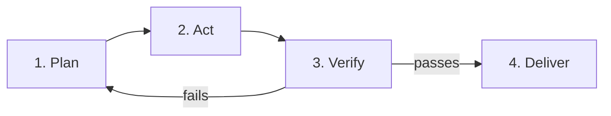

## The Agent Loop — the skeleton under every AI tool

Every AI coding tool, no matter the vendor or the year, runs the same loop.
It is the single most useful thing to understand about AI-assisted
development, because once you see it, you stop treating the tool as an oracle
and start treating it as a **process you supervise**.

> The loop is [Template Method](concepts/template-method) wearing a costume.
> The base class fixes the skeleton; subclasses fill the variable steps. With
> AI, *you* are the base class and the agent is the subclass — it fills the
> variable steps (the edits), and you own the invariant skeleton.

---

## The four steps

### 1. Plan

The agent restates the task and proposes an approach: which files, which
changes, which risks. If the task is a good contract, this step is short. If
the plan is long, the task was probably too big.

**Your job:** read the plan before the agent acts. Rejecting a plan costs
seconds; rejecting an implementation costs minutes. The plan review is the
cheapest checkpoint in the entire loop.

### 2. Act

The agent edits files, runs commands, and interprets results. This is the
step that makes it an *agent* rather than a chat box. It is also the step
where confidence outruns correctness — see the failure modes below.

### 3. Verify

The agent runs checks and reports back. **This is the step that only means
something if you re-run the checks yourself.** An agent's verification claim
is a hypothesis, not a result. If the DoD is a command, run the command.

### 4. Deliver

The agent declares completion and presents the diff. Completion, here, means
*"the DoD passed"* — never *"the agent believes it is done."* If there was no
DoD, there is no delivery; there is a first draft.

---

## The loop is where delegation goes wrong

| Failure | What happens | The fix |
|---|---|---|
| Skipping plan review | Agent builds the wrong thing *well* | Review the plan; reject early |
| Skipping your own verify | You ship the agent's self-report | Re-run the DoD yourself |
| No DoD at all | "Done" is whatever the agent thinks | Write acceptance criteria first |
| Vague redirection | "Try again" → same dice re-rolled | Name the failure + the criterion |

---

## The loop vs TDD

This platform's [Testing — Contracts, Not Code](concepts/testing) concept
taught the TDD loop: write the failing test, make it pass, refactor. The
agent loop is the same rhythm with the "make it pass" step delegated:

- **TDD** — you write the test (the contract), you write the code.
- **AI-assisted TDD** — you write the test, the *agent* writes the code, you
  run the test.

The test stays the boundary in both. That's why test-first work is the safest
possible thing to delegate: the acceptance criteria are already executable.

---

## Mental checklist

- [ ] Is this task small enough for one plan → act → verify pass?
- [ ] Have I read and approved the plan *before* it acted?
- [ ] Does my DoD name an exact command or test I will run myself?
- [ ] When it fails, am I redirecting with a reason, not re-rolling the dice?
- [ ] Am I paying for the loop, or doing the agent's half myself?
