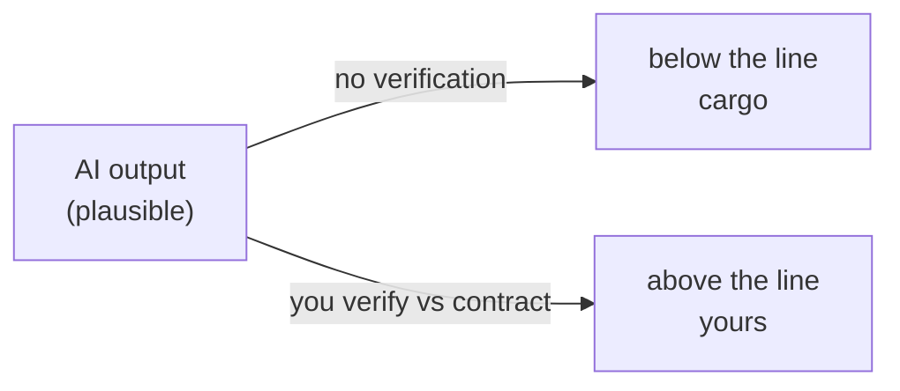

## The Trust Boundary — the AI produces, you own

The most important concept in AI-assisted development has nothing to do with
prompts or models. It is about **accountability**: who is answerable for a
piece of work. The answer, always, is you. The machine is fluent, fast, and
never accountable. Your whole job — in this paradigm — is to be the part that
*is* accountable.

> The trust boundary is the line between work the machine produced and work
> you have personally verified. Everything below the line is **cargo** until
> it crosses the line.

---

## The boundary moves by verification

Nothing the AI writes is automatically *yours*. It becomes yours when it has
been verified against a contract you understand. That's what crosses the
line: not *output* but *verified output*.

Notice what the crossing requires: a contract to check against. You cannot
verify against nothing. Which is why the [prompt contract](concepts/prompt-spec)
and the [agent loop](concepts/agent-loop) come first — the boundary is
meaningless without the checkpoints on either side of it.

---

## The four human-only decisions

Some work can never be delegated, because delegating it is delegating
accountability itself.

### 1. Architecture

Boundaries between components, data flow, ownership. The model sees the code
in front of it, not the system around it. An AI will happily choose the
pattern that fits locally and breaks globally.

### 2. Security

Authn/authz design, secrets handling, trust of input. A security mistake is
not a code defect — it is attack surface. One plausible-but-wrong decision
here is a breach with a byline.

### 3. Requirements

What the product must do and must not do. This is the contract at the top of
the stack. Delegate it and the model becomes the author of the business.

### 4. Acceptance

The decision that something is done and shippable. If the machine decides
this, it will always say yes.

---

## The context budget

The trust boundary has a physical constraint: the **context window**. The
model can only attend to what fits. Budget it like memory on a constrained
server:

- Contract first — highest-value text in the window.
- Minimum relevant files, not the whole module.
- Let the agent request the next file, instead of dumping everything up front.

A window full of irrelevant files is a window that has forgotten your
acceptance criteria.

---

## The boundary in practice

| Situation | Who decides | Because |
|---|---|---|
| "Implement this method to the contract" | Delegate the typing | The decision is made |
| "Add a new endpoint that returns X" | Human designs, AI drafts | The *shape* is architecture |
| "This AI-generated refactor passes tests" | Human reviews the diff | Tests can pass and the design be wrong |
| "Ship it" | Human only | Acceptance is not delegable |

---

## Mental checklist

- [ ] For each task, do I know which side of the boundary it belongs on?
- [ ] Have I verified the output myself — or am I trusting the self-report?
- [ ] Is the *decision* mine, even when the *typing* is the machine's?
- [ ] Would I stake my name on this piece of work? If not, it's still cargo.
