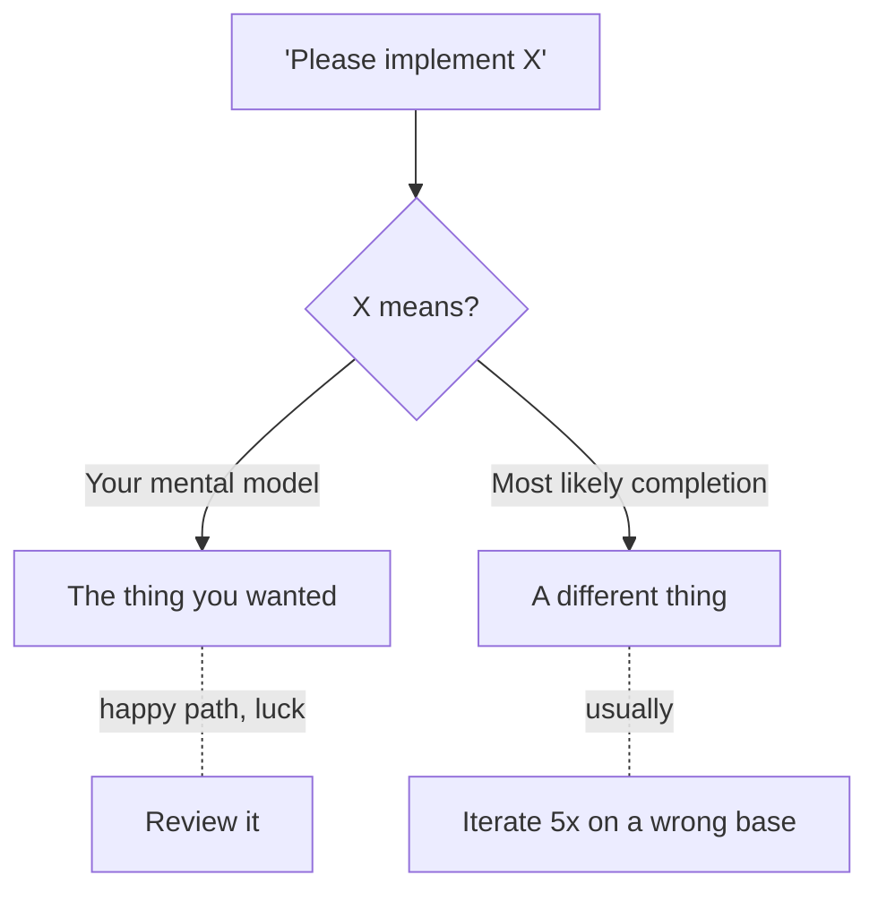

## Phase 2 — Prompts Are Contracts

Last phase gave you the vocabulary. This one gives you the tool: **the prompt
is a contract with a machine that will not ask clarifying questions.**

When you ask a human for a code change, they push back on ambiguity. An LLM
doesn't — it produces the most likely completion of *your* text. If your text
has three interpretations, you get one of them, confidently. The fix is to
write prompts the way this platform taught you to write contracts: bullet the
decisions, name the boundaries, state the acceptance criteria.

### The anatomy of a prompt-contract

> 🧠 **Definition — prompt contract**
>
> A **prompt contract** has four parts:
>
> 1. **Intent** — what problem you're solving, in one or two sentences.
> 2. **Context** — everything the tool must know that it can't infer: the
>    file layout, the relevant types, the constraints.
> 3. **Constraints** — what the answer *must not* do, plus the non-negotiables
>    (style, tests required, no new dependencies).
> 4. **Acceptance criteria** — how you will check the result. Tests to pass,
>    commands to run, properties to hold.
>
> Miss part 4 and you have a *wish*, not a contract. The machine will happily
> declare itself done without any definition of done.

### Why "please implement X" fails

The cost of a vague prompt is not a wrong answer. It's a wrong answer that
*looks* right, which costs you a review cycle before you even notice.

### The three big failure modes

| Failure mode | What it looks like | The contract fix |
|---|---|---|
| **Missing context** | The tool guesses your entity, your naming, your error policy | Paste the relevant file or state the shape explicitly |
| **Underspecified intent** | "Refactor this" → it refactors *nothing you meant* | State what behavior must stay identical |
| **No acceptance criteria** | The tool says "done" — by its definition, not yours | List the tests/commands that define done |

These map 1:1 to the three non-negotiable parts of a contract: intent,
context, acceptance criteria. A prompt that has all three is hard to get wrong;
a prompt that has none is impossible to get right.

### The meta-trick: ask it to check itself

> 🧠 **Definition — self-check request**
>
> The cheapest way to close a contract gap is to make the *machine* find it:
> append *"Before you start, list any assumptions you're making and any
> context you're missing. Do not write code until I confirm."* This converts
> a one-shot guess into a negotiation — exactly what a human reviewer would do.

### Tasks in this phase

1. Rewrite a vague prompt into a prompt-contract
2. Write the contract bullets an agent needs to implement a method
3. Name the missing context in a request
