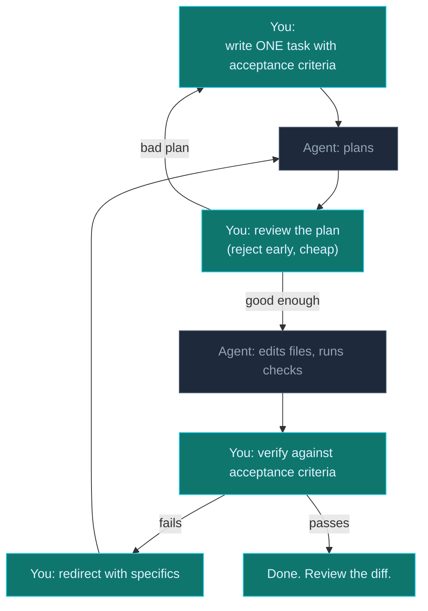

## Phase 3 — The Agent Loop in Practice

Phase 1 defined the loop. Phase 2 taught you to write one good contract. This
phase makes the loop *run* — which means learning how to drive an agent the
way you'd drive a junior engineer: decompose the work, review the plan, and
hold it to a definition of done.

### The loop, with the human in it

Notice what's *yours* and what's *the agent's*. You do: task decomposition,
plan review, verification, redirection. The agent does: the edits and the
mechanical checking. If you find yourself doing the agent's half, you're
paying twice.

### Decomposition: the unit of delegation

> 🧠 **Definition — task-shaped work**
>
> Work is **task-shaped** when it is:
>
> - **Small enough** for one plan → act → verify pass.
> - **Verifiable alone** — it has its own acceptance criteria, independent of
>   the next task.
> - **Single-intent** — one thing changes, one reason to reject it.
>
> A feature is not a task. A feature is five tasks: model, service method,
> endpoint, test, docs. Handing an agent "build the feature" is handing a
> junior "fix the app" — they'll produce volume, not correctness.

### The plan review — the cheapest checkpoint

The most expensive mistake in AI-assisted work is letting the agent *start*
on a plan you haven't read. Reading a plan takes 30 seconds. Reading an
implementation takes 30 minutes. Reject bad plans early:

- Does the plan touch files unrelated to the task?
- Does it invent structure (new abstractions, new deps) the task didn't ask for?
- Does it skip the verification step — "I'll just change it and see"?

Reject with a reason, not a mood. A plan review is a code review you get
*before* the code exists.

### Definition of done

> 🧠 **Definition — definition of done (DoD)**
>
> A **DoD** is the written answer to *"how will I know this is finished and
> correct?"* It is not the task title. It is the checklist:
>
> - Tests that exercise the new behavior pass (and you saw them fail first).
> - The exact command to prove it (name it).
> - No unrelated edits in the diff.
> - The change doesn't break the contract of anything it touches.
>
> Hand an agent a task with a DoD and it stops being able to fool you with
> "done." It either met the checklist or it didn't.

### Redirection, not restart

When verification fails, resist two reflexes:

- **"It's wrong, try again"** — a non-feedback loop. The agent rerolls the
  same dice.
- **Rewriting it yourself** — you've just hired yourself for the job you
  delegated.

Redirect with specifics: *"The error path throws instead of returning the
fallback; the acceptance criteria says the method must never throw. Fix the
error path only."* That is the same discipline as giving a failing test a
one-sentence reason.

### Tasks in this phase

1. Decompose a feature into task-shaped work
2. Critique an agent's plan
3. Write a definition of done for an AI-produced change
