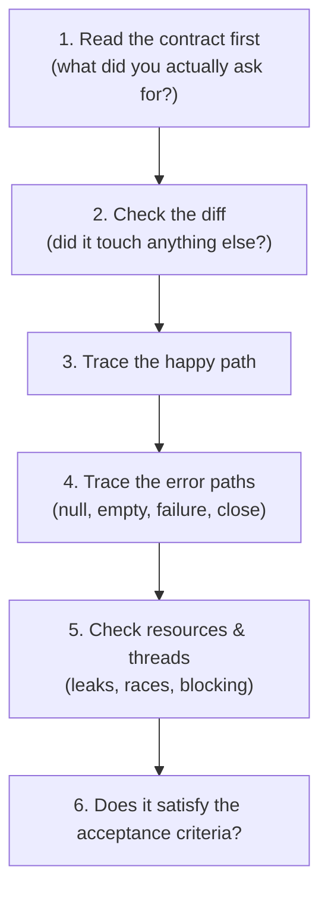

## Phase 4 — Reviewing AI Output

The machine produces plausible output by construction. Your entire edge over
it is the ability to read what it produced and find the gap between
*plausible* and *correct*. This phase trains that muscle on real Java.

### The honest framing

> 🧠 **Definition — plausible-but-wrong**
>
> **Plausible-but-wrong** output is code that reads fluently, uses the right
> imports, names things sensibly — and is subtly incorrect: a race, a
> resource leak, an off-by-one, a swallowed error. It passes the "does this
> look like code?" test and fails the "does this hold its contract?" test.
>
> The danger is not that the AI makes mistakes. It's that the mistakes are
> **confidence-shaped** — indistinguishable at a glance from correct code.
> You cannot glance-review AI output. You must *review against the contract*.

### What to look for, in order

Steps 3–5 are where plausible-but-wrong lives. Happy paths are what the model
has seen a million times. Error paths, resource lifetimes, and concurrency are
where its confidence outruns its competence.

### The hallucination, specifically

> 🧠 **Definition — hallucination**
>
> A **hallucination** is output that asserts something untrue as if it were
> fact — a library that doesn't exist, a method with the wrong signature, an
> API from a different version. It's not laziness; it's the model generating
> the most plausible completion, and "plausible" is exactly what a wrong API
> looks like.
>
> - ✅ Cross-check every unfamiliar symbol against the actual dependency tree.
> - ✅ If it doesn't compile, the compiler is the fastest reviewer.
> - ❌ "Fix the import to match what it means" — if the API doesn't exist, the
>   design assumption is wrong, not the import.

### The review checklist

| Check | Question to ask |
|---|---|
| Contract | Does this do what I asked — nothing more, nothing less? |
| Diff scope | Are there edits in files this task didn't touch? |
| Happy path | Trace it: does the obvious input produce the obvious output? |
| Error paths | Null? Empty? Missing resource? Does it throw or crash? |
| Resources | Is every stream/connection/thread closed or released? |
| Concurrency | Shared mutable state? Atomicity? Blocking on a pool thread? |
| Acceptance | Run the DoD checks yourself. Don't trust the claim. |

This checklist is the same thing this platform has been training since Nexus
Phase 1 — contracts and tests — pointed at the machine's output instead of a
colleague's.

### Tasks in this phase

1. Fix plausible-but-buggy AI-generated Java (race condition)
2. Spot the hallucinated API
3. Write the verification tests the AI's output was missing
