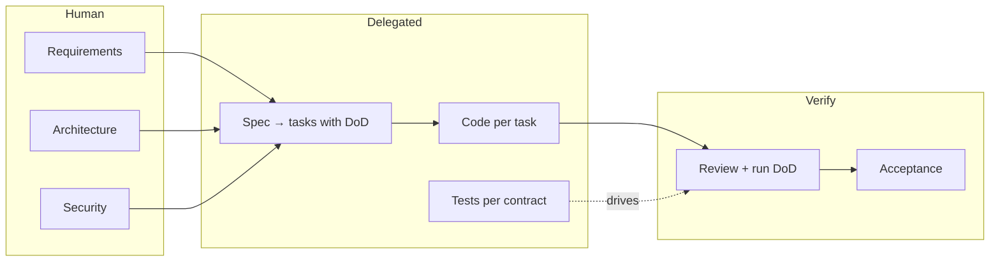

## Phase 5 — Delegation Boundaries

By now you can write a contract, drive a loop, and review the output. The
final phase is judgment: **what should be delegated at all, and what must
stay human.** Delegation isn't a dial you turn to 11. It's a policy, and
policies belong on paper before they're needed in a crisis.

### What must stay human

> 🧠 **Definition — trust boundary**
>
> The **trust boundary** is the line between work the machine produced and
> work you have personally verified. Everything below the line is cargo until
> it crosses the line. The boundary moves by verification, not by vibes.
>
> What *never* crosses it — the four human-only decisions:
>
> 1. **Architecture** — boundaries between components, data flow, what a
>    service owns. An AI will happily pick a pattern that fits the code in
>    front of it and ignores the system around it.
> 2. **Security** — authn/authz design, secrets handling, what untrusted
>    input is allowed to do. Mistakes here are not "code defects," they are
>    attack surface.
> 3. **Requirements** — what the product must do and must not do. This is the
>    contract at the top of the whole stack; delegating it is delegating the
>    business.
> 4. **Acceptance** — the decision that something is done and shippable. If
>    the machine decides this, it will always say yes.

Everything else — implementation, refactors, boilerplate, tests for a stated
contract, docs — is fair game for delegation.

### The delegation matrix

| Work type | Delegate? | Why |
|---|---|---|
| Implement to a written contract | ✅ | The decision is made; the typing is mechanical |
| Boilerplate / glue / migrations | ✅ | Low risk, high volume |
| Refactor with pinned behavior | ✅ | If the tests already define the contract |
| Exploratory "what if" prototypes | ✅ | Cheap ideas, throwaway |
| Tests for a contract you wrote | ✅ | The contract is the spec; the test is transcription |
| Architecture decisions | ❌ | System context the model can't see |
| Security design | ❌ | Attack surface; one plausible wrong = one breach |
| Requirements / product definition | ❌ | The top of the decision stack |
| Final acceptance & sign-off | ❌ | Accountability is not delegable |

### The context budget

> 🧠 **Definition — context budget**
>
> Every AI tool has a **context window**: the total text it can hold and
> attend to at once. It is finite, and you must budget it the way you budget
> memory on a constrained server:
>
> - Put the *contract* in first — it's the highest-value text in the window.
> - Paste the *minimum* relevant files, not the module.
> - Let it ask for what it needs next instead of dumping everything up front.
>
> A window full of irrelevant files is a window that has already forgotten
> your acceptance criteria.

### The workflow you're building toward

The pipeline works because every handoff is a contract with acceptance
criteria — exactly the habit this platform installed from day one. The AI
tools paradigm is not a different way of developing. It's the *same* way, with
the typing outsourced and the deciding kept.

### Tasks in this phase

1. Build your personal delegation policy
2. Design an agent pipeline for a release (with a diagram)
3. Decide per-file: delegate or human
