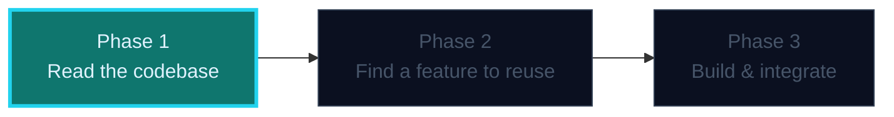

## Phase 1 — Read a Modular Java Codebase

Before you change anything, read the shape of the project. JJazzLab is a
**NetBeans Platform application** — an open-source Java desktop app made of
many **Maven modules**, not one big folder.

### Where this fits



> Brightly lit = **what this phase builds**. Outlined = coming up.

---

### The three things to see instantly

> 🧠 **Module = a jar with a public surface.** A NetBeans module is a Maven
> artifact (`<packaging>nbm</packaging>`) that exposes only the packages you
> declare as `<publicPackage>`. Everything else is private.

1. **The module graph** — the parent `pom.xml` lists `<modules>`. Read it like
   a map of the whole app.
2. **Dependency direction** — each module's `pom.xml` lists what it depends on.
   Dependencies must form a **DAG**: no cycles. `InstrumentComponents` depends
   on `Harmony`, never the other way around.
3. **The build target** — a `compiler.release` property (e.g. `25`) tells you
   the Java version the compiler targets. You need a JDK **>=** that.

```xml
<!-- parent pom.xml -->
<packaging>pom</packaging>
<modules>
  <module>model/Harmony</module>
  <module>app/InstrumentComponents</module>
  <module>app/CL_EditorImpl</module>
</modules>
```

### Why you read the module graph first
A change in a low module ripples *up* to its consumers. If you add a feature to
`CL_EditorImpl` that needs `InstrumentComponents`, you must confirm `CL_EditorImpl`
can depend on it **without creating a cycle**. That single decision determines
whether your plan is even possible.

### The one-sentence takeaway
**Read the DAG, find the public surface, and check the target release — then you
know what changes are safe before you write a line.**
